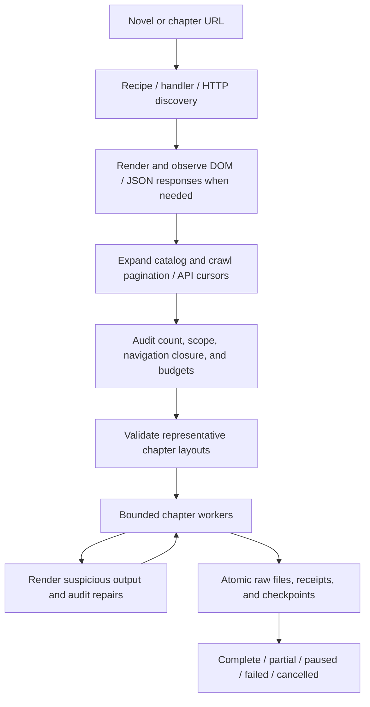

# Autonomous novel discovery and extraction

NouSetsu accepts a novel landing-page or chapter URL, discovers its accessible catalog,
validates extraction, and saves raw Markdown in the selected project folder.
Translation is a separate action. Unknown layouts have bounded recovery; CAPTCHA,
expired sessions, inaccessible paid content, and unsupported image/canvas chapters
produce explicit blockers.

## Using Web Studio

In Upload Chapters, choose the URL tab and enter the URL. **Scrape & Import**
can start directly; **Inspect TOC** is optional when you want a preview or a range.
Inspection in an existing project returns an identifier that extraction uses to
reuse the catalog snapshot.

The progress panel shows discovery, validation, downloading, repair, and terminal
status. Partial or paused runs remain visible. **Stop extraction** retains verified
files; **Resume extraction** retries the same job. Reopening the modal restores the
latest unfinished job. Renew an expired session before resuming.

Existing files are protected by default. Source receipts bind a canonical URL to
its output filename and SHA-256 hash. Changing a title does not create a second
file. A different source cannot replace an occupied chapter index, including when
overwrite is enabled. Explicit overwrite updates a file owned by the same source.

## Workflow and acceptance rules



- Discovery reads embedded state and DOM links, recursively visits observed
  pagination and cursor endpoints, accumulates virtualized lists while scrolling,
  and can follow an evidenced previous/next chapter chain when no TOC exists.
- Conflicting novel identifiers and external chapter candidates are rejected.
  Ambiguous route layouts still require chapter validation. Model output does
  not establish catalog coverage.
- The advertised count, discovered count, confidence, issues, and completeness
  evidence are separate. An incomplete or empty catalog stays incomplete.
- Browser actions are typed clicks, scrolling, and stopping. Click targets are
  witnessed controls; model suggestions are not executable scripts.
- Initial validation samples first, middle, and last chapters, plus observed volume
  boundaries or quarter points, up to five representative samples. A new layout
  encountered in the batch requires its own audited repair before use.
- Reviews receive actual beginning, middle, and ending excerpts. Extraction
  preserves direct prose, inline markup, paragraph blocks, and line breaks.
- Chapter continuations must retain chapter identity. Failed, cyclic, inaccessible,
  or unfinished continuations cannot be published as complete chapters.
- Each requested chapter receives an outcome. Exceptions and access blocks are
  counted; failed chapters do not become placeholder Markdown.
- Working recipes are retained under versions by domain, structural fingerprint,
  and route family. Warm verified recipes use deterministic checks without
  another model call. Concurrent repairs for the same layout share one result.

## Jobs, sessions, and configuration

Project-local runtime files live under `.novel/scraper/`:

| Directory | Purpose |
| --- | --- |
| `jobs/` | Persisted requests and status; cancellation markers |
| `inspections/` | Preview catalogs identified by inspection ID |
| `snapshots/` | Catalog snapshot for each extraction job |
| `checkpoints/<job>/` | One atomic record per source: outcome, hash, attempts, and recipe fingerprint |
| `sources-*/` | Source ownership receipts scoped to the output directory |
| `locks/` | Process-owned destination locks that release on interruption |
| `results/` | Job-scoped terminal payloads for large catalogs |

A backend restart recovers a previously running job as paused when its status is
read or jobs are listed. Resume validates saved file hashes before skipping work.
Incomplete catalogs are rediscovered on retry. If new ordering conflicts with
existing chapter indices, files stay protected and the conflict is reported.

Provider credentials and browser state are excluded from job documents and
recipes. Use a Playwright storage-state file from an authorized session via
`NOVEL_SCRAPER_STORAGE_STATE`, project `scraper_session_state`, or extraction
request `session_state`. Project-relative paths resolve against the project root.
Keep the state file private; it contains authentication material. HTTP preserves
cookie domain/path scope; browser contexts also restore local storage and browser
state. An HTTP authorization failure can escalate to the authenticated browser.

Budget precedence is extraction request `budgets`, project `scraper_budgets`,
machine environment, then defaults:

| Budget key | Environment variable | Default |
| --- | --- | --- |
| `toc_cycles` | `NOVEL_SCRAPER_TOC_CYCLES` | 8 |
| `review_iterations` | `NOVEL_SCRAPER_REVIEW_ITERATIONS` | 6 |
| `repair_attempts` | `NOVEL_SCRAPER_REPAIR_ATTEMPTS` | 3 per layout |
| `discovery_seconds` | `NOVEL_SCRAPER_DISCOVERY_SECONDS` | 600 |
| `toc_pages` | `NOVEL_SCRAPER_TOC_PAGES` | 1000 |
| `browser_pages` | `NOVEL_SCRAPER_BROWSER_PAGES` | 2 per origin |
| `request_attempts` | `NOVEL_SCRAPER_REQUEST_ATTEMPTS` | 3 |
| `no_progress_attempts` | `NOVEL_SCRAPER_NO_PROGRESS_ATTEMPTS` | 2 |

Chapter concurrency defaults to three and accepts 1–10 workers. One HTTP client
is pooled per extraction runtime; browser contexts are reused per origin with
bounded pages. Each owned browser server uses an isolated port. Request pacing
and Retry-After cooldowns are shared within that runtime. Development/CLI runs
discover the scraper checkout and interpreter; packaged desktop builds retain
the bundled `--scraper-worker` entrypoint and app-data recipe storage.

Recovery defaults to `NOVEL_SCRAPER_RECOVERY_MODE=standard`. Set it to `maximum`
to use a 900-second discovery budget, 16 TOC cycles, five repair attempts, ten
ranked candidates, and two visual attempts. Explicit `NOVEL_SCRAPER_<LIMIT>`
overrides take precedence over profile defaults; project and request budgets
retain their existing precedence. Browser cleanup defaults to five seconds
(`NOVEL_SCRAPER_CLEANUP_SECONDS`). NouSetsu's inspection timeout allows the
effective discovery budget plus cleanup and 15 seconds for process overhead.

Visual recovery remains opt-in through `NOVEL_SCRAPER_VISUAL_RECOVERY=1` and
requires an image-capable model. It sends in-memory viewport screenshots to the
configured provider to choose among witnessed controls. Maximum mode alone
does not enable it.

Example project configuration:

```yaml
scraper_budgets:
  discovery_seconds: 600
  toc_pages: 1000
scraper_session_state: .novel/scraper/sessions/authorized.json
```

## API and standalone CLI

| Method and route | Behavior |
| --- | --- |
| `GET /api/scraper/check` | Runtime availability and non-secret model route |
| `POST /api/scraper/inspect` | Discover metadata, catalog, issues, coverage evidence |
| `POST /api/scraper/extract` | Start extraction from URL and project/folder |
| `GET /api/scraper/status/{task_id}` | Status; use `project_path` for restart recovery |
| `GET /api/scraper/jobs` | List project jobs; requires `project_path` |
| `POST /api/scraper/cancel/{task_id}` | Request cancellation; requires `project_path` |
| `POST /api/scraper/resume/{task_id}` | Resume the same job; requires `project_path` |

Extraction retains range/custom selection, frontmatter, concurrency, and overwrite
arguments. Additive fields include `inspection_id`, `session_state`, and `budgets`.
Empty or nonexistent explicit selections are errors. Counts describe saved,
skipped, failed, blocked, and cancelled chapters. Only `completed` denotes both
resolved catalog coverage and all selected output verified.

The subprocess protocol requires one explicit terminal JSON event and a successful
exit. Both output pipes are drained; old destination files never imply success.
Large terminal payloads use an atomic job-scoped result file so the JSON-lines
event stays bounded. Chapter checkpoint and receipt writes remain constant-size
as the catalog grows.

Inspection responses and saved inspection snapshots retain `final_url`,
`source_scope`, `linked_entry_count`, `observed_linked_entry_count`,
`highest_chapter_number`, `highest_observed_chapter_number`, and
`numbered_chapter_ranges` (each with `url`, `start`, and `end`). Linked entries and
chapter-number labels are distinct: a post containing chapters 1–3 is one entry.
Observed labels do not establish accessible or complete coverage. These fields
are additive; older workers and snapshots can omit them. Recovery measurements
remain available under `metrics.recovery_stages`.

From `modules/novel_scraper`, with the main project's installed runtime:

```powershell
uv run --project ../.. python -m src.main --auto --url https://example.org/novel
uv run --project ../.. python -m src.api_bridge extract --url https://example.org/novel --dest ./raw --state-dir ./.scraper-state --job-id novel-job
```

The headless CLI shares the autonomous extraction engine and uses a stable URL
job identity for restart. The JSON worker accepts `--indices`, `--start`,
`--end`, `--concurrency`, `--frontmatter`, `--overwrite`, and `--snapshot-file`.

## Verification and performance

Run both repositories separately to keep their `src` namespaces isolated:

```powershell
uv run --no-sync pytest
# Then, from modules/novel_scraper:
uv run --no-sync --project ../.. python -m pytest
uv run --no-sync --project ../.. python -m pytest tests/test_autonomous.py -k benchmark -s
```

The benchmark uses synthetic HTML, a mocked model, and local disk writes. It
compares cold and warm discovery/extraction on identical chapter inputs and
checks that warm recipes make zero model calls. Its throughput is an offline
baseline, not a claim about live website speed.

External acceptance is opt-in with `NOVEL_SCRAPER_LIVE_TESTS=1`. Set
`NOVEL_SCRAPER_LIVE_MATRIX` to a JSON array of entries with `url`, optional
`name`, and optional `session_state` to include unfamiliar static, JavaScript,
paginated, and authorized signed-in sites. Keep this private configuration outside
Git. A live result must provide validated catalog evidence or an explicit blocker;
no universal website success guarantee is made. OCR and automatic translation
are outside this version.
