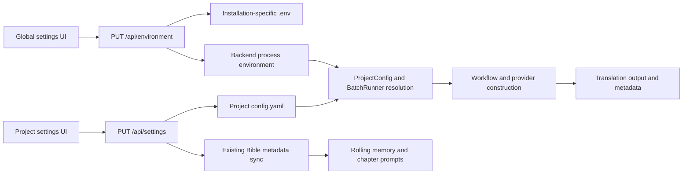

# Settings E2E Audit and Improvement Review

Audit dates: 2026-10-12–2026-10-13, Asia/Bangkok. Source baseline: `81d4691ac5bc046b14b99d8eea45a51fff333fdb`.

**The settings implementation does not pass full E2E signoff.** The audit reproduces unsafe configuration validation, inconsistent precedence, ineffective controls, and UI discrepancies. Product behavior, public APIs, and dependencies have not been changed. Added code consists of diagnostic tests and isolated audit tooling.

## Verification and evidence

| Surface | Evidence | Result |
| --- | --- | --- |
| Complete Python suite | [JUnit](audit-results/settings/full-suite-junit.xml) | **630 passed**, no errors/failures/skips; 56.88s, two warnings |
| Audit evidence integrity | [JUnit](audit-results/settings/audit-tools-junit.xml) | **2 passed**; missing/failed source evidence never produces a pass, measured shared failures are mapped, and a later pass cannot erase a failure |
| Focused source settings/runtime investigation | [Findings](audit-results/settings/backend-findings.md), [results](audit-results/settings/backend-source-results.json) | **145 cases passed**, including 93 new diagnostics; actual API jobs, source provider spies, restart and read-only-file checks |
| Development and built browser UI with real source backend | [Findings](audit-results/settings/browser-findings.md), [Playwright results](audit-results/settings/browser-playwright.json) | **14/14 cases passed**; each mode exercises 61 project field paths, 51 global values and five secret lifecycles |
| Newly frozen backend, direct real HTTP API | [Results](audit-results/settings/frozen-results.json), [captured provider parameters](audit-results/settings/provider-captures.json) | **102 observations**; two confirmed product failures; completed five-stage local-provider translation and successful restart |
| Actual Tauri development/source backend | [Browser-driven native results](audit-results/settings/native-dev-cdp-results.json), [earlier UI observations](audit-results/settings/native-dev-results.json) | **117 setting paths** through the real WebView2, real API and disk, plus a fresh UI-started completed translation |
| Actual Tauri release/frozen backend | [Browser-driven native results](audit-results/settings/native-release-cdp-results.json), [lifecycle](audit-results/settings/native-release-lifecycle.json) | **117 setting paths**, synthetic key lifecycle, completed UI-started translation, restart persistence, exact template seeding and app-data fallback |

Passing diagnostic tests mean that the observations are reproducible; they do **not** accept the observed bugs as correct product behavior. Tests named `observed` deliberately characterize defects so the report can be verified without shipping fixes. Convert these to desired-behavior regression tests when implementing repairs.

[Inventory](audit-results/settings/setting-inventory.csv) contains **144 unique settings and actions**, with UI/API names, types, schema/effective defaults, constraints, persistence, inheritance/reset rules, consumer references and application timing. [Setting-by-mode matrix](audit-results/settings/setting-mode-matrix.csv) records measured statuses and explicit blocked reasons. [Summary](audit-results/settings/matrix-summary.json) counts those statuses. A persistence pass does not establish all runtime effects or commercial-provider acceptance; source failures are linked separately rather than invented as native UI observations.

| Matrix surface | Pass | Fail | Not applicable | Blocked |
| --- | ---: | ---: | ---: | ---: |
| Source API/ASGI | 97 | 34 | 10 | 3 |
| Frozen HTTP API | 118 | 2 | 11 | 13 |
| Development browser | 108 | 17 | 12 | 7 |
| Built browser | 108 | 17 | 12 | 7 |
| Development native WebView | 118 | 0 | 13 | 13 |
| Packaged native WebView | 118 | 0 | 13 | 13 |

Native rows include the 117 editable paths plus their generation-map aggregate. Their zero observed failures describe the successful save/reload scenarios, **not** defect-free runtime behavior; the source and browser defect reproductions remain applicable evidence. Blocked action/creation checks prevent a claim of exhaustive every-scenario signoff.

## End-to-end configuration paths



The same React settings view is used by browser and Tauri. Development Tauri starts source Python and points it at its repository `.env`; packaged Tauri seeds an app-data `.env`, starts the frozen sidecar, and chooses an install-local projects/logs directory with app-data fallback. The audit shell uses `com.nousetsu.settingsaudit`, a disposable source snapshot and its own registry. [Provenance](audit-results/settings/provenance.json) distinguishes pre-existing binaries of unverified source identity from fresh audit builds.

Following the user's 2026-10-13 instruction, resumed native checks use **Playwright connected over CDP to the actual Tauri WebView2**, not computer-use tools. The debugging port and browser profiles are enabled only in the audit process environment. No Tauri globals are mocked and no product configuration/source files are edited. This follows the official [Playwright WebView2 procedure](https://playwright.dev/docs/webview2). Earlier computer-use observations are retained as historical evidence, not represented as tools used after the instruction.

Actual review/quota precedence is **constructor → environment → project → built-in**. Model routes use their own project/role/shared rules, including scraper-specific precedence; generation controls preserve nullable role overrides and valid zero/false values. The report does not assume that all settings share one resolver.

## Prioritized improvements

| Priority | Finding and practical consequence | Reproduction / evidence | Focused improvement |
| --- | --- | --- | --- |
| P1 | Invalid project settings are accepted and can make the entire configuration reload as defaults | Save `max_review_loops=99`, `quality_threshold=0`, or `rag_top_k=99`. PUT returns success; subsequent `load_config` validation fails and silently returns a fresh default config. Source B01; frozen `invalid_review_loop`. | Validate a complete candidate config before writing. Reject invalid values with field-specific errors and surface corrupt-file failures rather than substituting defaults silently. |
| P1 | Global numeric/generation values lack semantic validation | Save review loops `not-a-number`, TPM `-1`, or shared temperature `3`. Source/browser prove persistence; malformed review loops fail runner construction. B02 plus browser malformed-values observation. | Validate allowlisted globals by type, bounds and related-field constraints before any persistence. |
| P1 | Project review and quota controls disagree with runtime | Set conflicting project/environment loops, threshold, TPM or RPM. GET displays project values while `BatchRunner` selects environment values. B03. | Use one authoritative resolver for both displayed effective values and runtime, following the chosen project-override policy. |
| P1 | Scene-character filtering toggle is ineffective | Save false; actual drafting still filters out an absent supporting character. No runtime consumer reads `filter_scene_characters`. B09. | Wire the resolved flag through workflow and affected agents; assert prompt contents with each value. |
| P1 | Cross-volume memory toggle is ineffective | Save `cross_folder_summaries=false`; Bible remains true and actual rolling retrieval uses true. B10. | Resolve one authoritative flag for rolling memory or synchronize it coherently with the Bible. |
| P1 | Project dotenv state can leak across projects | Load normal project A's `.env`, then B's: A's process-loaded values remain. Central values can also prevent intended project dotenv overrides. B05. | Resolve project defaults into a project-local mapping instead of mutating shared process state. Keep machine-level updates separate. |
| P1 | A stale full-form save overwrites newer changes | Open two forms; A saves a title, B changes only genre but resubmits its old title. Reproduced in both browser modes, B14. | Save dirty fields and/or require a revision precondition; report conflicts explicitly. |
| P2 | Project/global inheritance and reset semantics are inconsistent | Concrete reconciliation default true masks environment false (B04). Legacy `use_interactions_api=null` cannot clear false (B08); UI clear-all leaves it active for all six roles. | Use explicit inheritance states for nullable overrides. Clear legacy controls alongside role overrides, with an explicit compatibility/migration policy. |
| P2 | An inherited false extractor setting is displayed as enabled | Project raw value null plus environment false resolves false in the actual runner, while UI `!== false` displays checked true. Source and both browser modes. | Render the resolved value and expose inheritance separately from on/off. |
| P2 | Project Boolean string values are misinterpreted | PUT string `"false"` persists true for supported Boolean fields; native JSON false works. B07. | Use typed validation or deliberately parse accepted strings; do not call `bool` on unvalidated request values. |
| P2 | Keyboard save changes blank chunk defaults unexpectedly | Clear threshold/size and press Ctrl+S: **85/70** saved instead of displayed/blur/schema **800/400**. Both browser modes. | Derive display, blur and save defaults from the same definition. |
| P2 | Zero chunk overlap is not honored | Save zero; chunked drafting still sends the previous draft's last three lines. Constructor zero also falls through `or`. B11. | Pass configured overlap into context construction; resolve zero using `is not None`. |
| P2 | Global model saves leave project effective displays stale | Change global primary model after clearing overrides; fresh API GET updates but the project placeholder stays old. Both browser modes. | Refresh resolved project settings after global saves. |
| P2 | Applying the model preset omits the scraper route | Current `.env` preset includes scraper; applying it saves the other routes and leaves scraper null. Separate Load `.env` behaves differently. Both browser modes. | Apply every route in the preset consistently, including scraper. |
| P2 | Multi-file/multi-key saves can report inconsistent results | Bible save failure is swallowed after config persistence (B12); an injected second dotenv-key failure leaves the first key on disk and process state unchanged (B13). | Use an atomic dotenv replacement and publish process values after success. Make config/Bible partial failure recoverable and visible. |
| P2 | Unsupported fields silently report successful saves | Five procedural project fields are exposed in nested GET config but ignored by PUT; frozen interval probe reproduces it. B15. | Reject unsupported fields or deliberately expose/persist the controls. Keep read-only fields explicit. |
| P2 | Saved language defaults are ignored by web creation | Global Chinese/French defaults plus omitted creation languages produce Japanese/Thai. B16. | Resolve omitted creation languages from saved defaults while preserving explicit form choices. |
| P2 | An empty registry can block access to global settings | Startup requests chapters for an uninitialized fallback directory and receives HTTP 400. Both browser modes require Skip & Continue before globals. | Allow machine settings when no valid project exists; gate chapter-dependent services separately. |
| P2 | Several controls lack usable accessible labels | All Project Settings has **10 unnamed switches** and **29 unassociated labels** in both browser modes. | Associate each input/select with its label and name every switch. |

Google transport probes additionally show that retained `thinking_budget` is absent from Interactions requests while the non-Interactions Google transport receives zero correctly (B17). Treat this as a **provider-capability/UI explanation issue**, not evidence that adding a budget field to Interactions would work. The current official [thinking guide](https://ai.google.dev/gemini-api/docs/thinking) documents `thinking_level` for Interactions. No live-provider compatibility claim is made.

## Backend reuse and storage context

[The owned reuse experiment](audit-results/settings/native-backend-reuse.json) confirms that a packaged app accepts a source backend advertising the same desktop version and consequently uses that backend's `.env`, registry and settings context. Compatibility currently checks the version, not installation identity. This is validated sharing behavior, rather than a defect against an unstated policy. Show the connected backend's mode/owner and settings file prominently; require installation affinity if independent per-install defaults are intended.

The experiment explicitly advertised version 0.5.2 as development Tauri does. Without that fixture override, the no-sync environment's older installed package metadata reports 0.5.1, which the 0.5.2 desktop correctly rejects. That initial refusal was a test-environment version mismatch, not evidence of broken compatibility validation.

## Runtime timing, successful behavior and limits

- Actual source API jobs capture settings at runner construction. Saving drafter temperature 0.3 → 0.7 and disabling patch polishing while a controlled job is active leaves that job's captured controls unchanged; the next actual API job uses the new controls and produces output.
- Model overrides clear through empty/whitespace/null values. Role generation maps validate nested types/ranges, preserve zero temperature/budget and false Interactions, and restore inheritance when cleared. Primary/fallback source spies and injected transport failures validate parameter transfer without live calls.
- The fresh frozen executable called the local custom-provider stub for extractor/drafter/critic/polisher/chronicler with temperatures 0.1/0.2/0.3/0.4/0.5. Completed checkpoint metadata and `0001.md` verify success beyond an idle job flag. Config survived process restart.
- Valid project fields persist through YAML, fresh app reload and project B isolation. Global values persist and clear; blank secret inputs preserve credentials, explicit clear removes them, and response bodies do not return secret material. Browser and real native WebView checks cover synthetic key lifecycles; standalone frozen evidence covers replacement/status/redaction rather than every lifecycle branch.
- A real temporary Windows read-only `.env` correctly returned HTTP 500 without changing disk or process values. This does not eliminate B13's separate multi-key partial-write defect.
- Source runtime checks cover review thresholds/regression protection, configured chunk triggering, safety setting propagation, RAG top-k/disabled reranking, filtering/reconciliation and existing pause/resume behavior. A settings change during a paused checkpoint is not asserted to preserve identical translation quality.
- Synthetic fixtures and loopback provider transports are used throughout. The browser fixture blocks nonlocal connections. An early no-project browser harness iteration read the repository's fallback `.novel`; it did not save host settings. The final harness changes CWD to its temporary root, and final browser evidence contains only isolated fixtures.
- Actual packaged restart preserves `.env` and YAML bytes. Removing only the audit `.env` after preserving a backup makes first launch copy the bundled template byte-for-byte; the prior audited settings are then restored. An install copy with regular files blocking `project` and `logs` directory creation falls back to app data. This tests the actual filesystem-failure branch; Windows ACL permission denial itself is not simulated.
- All **117 editable field paths** were exercised in each native mode. The matrix also includes aggregate containers, read-only/schema-only fields, settings actions and creation-modal fields. Remaining blocked cells concern independently unexercised actions/creation inputs; they must not be read as missing coverage of the 117 editable controls. A native persistence pass does not cancel separately reproduced source runtime defects.
- Live providers, updater installation, external log-folder windows, and full accessibility certification are excluded. Source factory spies cover Google/Interactions parameters; the native jobs use mock models and do not prove commercial-provider behavior. The independent review corrected omitted shared failures in the matrix and stale browser evidence on failed reruns; integrity tests fail closed when source evidence is missing or failed.

## Reproduction

Run source checks using the repository environment:

```powershell
uv run --no-sync pytest tests/test_settings_audit.py -q
uv run --no-sync pytest -q
```

Build the frontend in an isolated snapshot rather than replacing tracked `web/dist`:

```powershell
uv run --no-sync python scripts/audit/settings_runtime_audit.py prepare
```

Run `npm run build` in the printed snapshot's `web` directory, then use its dist path for real browser E2E:

```powershell
$env:NOUSETSU_SETTINGS_AUDIT_DIST = '<snapshot>/web/dist'
Set-Location web
node node_modules/@playwright/test/cli.js test --config playwright.settings-audit.config.ts
Set-Location ..
```

Freeze the snapshot with its existing `src-tauri/build_sidecar.py`, then run the direct audit on the resulting binary. The helper reserves its own loopback ports and refuses to launch native checks if port 15474 is occupied:

```powershell
uv run --no-sync python scripts/audit/settings_runtime_audit.py frozen --binary '<snapshot>/src-tauri/binaries/nousetsu-backend/nousetsu-backend.exe'
uv run --no-sync python scripts/audit/settings_results.py
```

For repeatable real native UI checks without computer use, build the audit shell in the snapshot with its generated `tauri-audit.json`, launch one mode at a time, and attach Playwright to the private WebView2 port:

```powershell
uv run --no-sync python scripts/audit/settings_runtime_audit.py native-release
node scripts/audit/native_webview_audit.mjs release
uv run --no-sync python scripts/audit/native_lifecycle_audit.py stop-release
```

Use `native-dev` and `node scripts/audit/native_webview_audit.mjs dev` with the audit Vite server on 5187 for development mode. Native lifecycle tooling verifies owned executable paths before stopping any processes. Ports 15474 and 5195 must be available; do not stop unrelated listeners. Native jobs create a new fixture chapter and verify its completed metadata/output so existing completed chapters cannot falsely establish a successful new translation.

Browser controls/API serializers are exercised unchanged. Audit-only fixture endpoints live only in `scripts/audit/settings_fixture_server.py`; they are not added to the product API.
